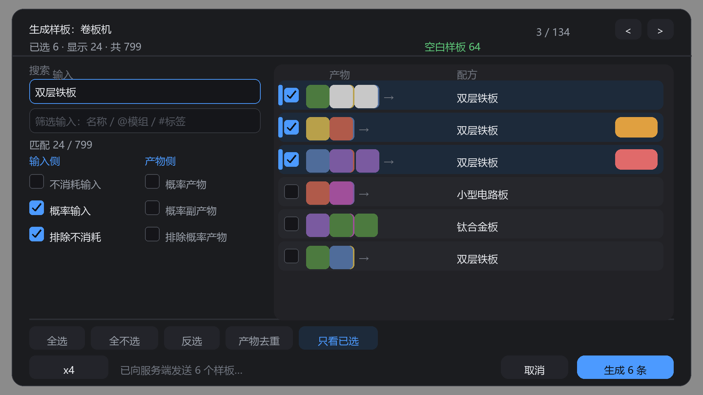
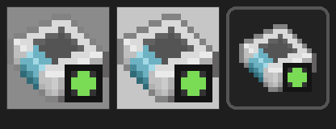
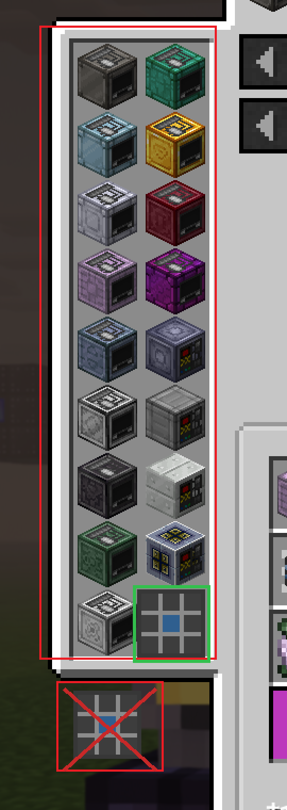

# EAE2 Pattern

**Efficient AE2 Pattern — turn everything a JEI workbench can do into encoded AE2 patterns, in one click.**

把 JEI 里某台机器能做的全部配方，一键变成已编码的 AE2 样板并写进 ME 网络 —— 不用再对着样板编码终端一条条手搓。

| | |
|---|---|
| Minecraft | 1.20.1 |
| Forge | 47.4.16+ |
| 必须安装 | Applied Energistics 2 `15.2.x`、Just Enough Items `15.20.x`（客户端） |
| 环境 | 客户端 + 服务端（编码与入库都在服务端） |
| 许可证 | MIT |

---

## 目录

- [它解决什么问题](#它解决什么问题)
- [安装](#安装)
- [怎么用](#怎么用)
- [生成规则](#生成规则)
- [配置](#配置)
- [构建](#构建)
- [版本号与分支](#版本号与分支)
- [项目结构](#项目结构)
- [出问题先看日志](#出问题先看日志)
- [已知限制](#已知限制)

---

## 它解决什么问题

AE2 的样板编码终端很聪明，但它是**一次一条**的：选配方、点编码、换下一个。给一台 GregTech 卷板机配齐 799 条样板，手点是几个小时的事，而且中间但凡有一次放错槽位，那条样板就会永远合成出错误的东西。

EAE2 Pattern 换了个方向：**配方数据本来就在 JEI 里**。既然 JEI 知道这台机器能做什么、每个槽位吃什么、产出什么，那就让它一次性把这些全变成样板。

```text
JEI 配方页 → 点左侧竖条里的九宫格按钮 → 预览勾选 → 生成 → 服务端编码 → 写入 ME 网络
```

## 安装

1. 装好 Minecraft 1.20.1 + Forge 47.4.16（或更高 47.x）。
2. 把 `eae2-pattern-<version>.jar` 放进 `mods/`。
3. 确认 `mods/` 里同时有 **AE2 15.2.x** 和 **JEI 15.20.x**。
4. 服务端也要放同一个 jar —— 采集在客户端，编码和入库在服务端。

## 怎么用

### 入口一：JEI 配方页里的按钮（主要入口）

打开任意一台机器的 JEI 配方页。**左侧那一列是「哪些方块能做这个配方」**（JEI 的催化剂竖条），按钮是这条竖条里的**下一个空槽位**：一个 16×16 的图标 —— **AE2 自己的空白样板贴图**，右下角加一个绿色「＋」徽章（表示「拿空白样板批量生成」），跟机器图标同样大小、同在 JEI 的面板里。竖条正好排满时，它会贴在竖条正下方并自己带一小块底板，不会飘在面板外面。

点击它 → 进入采集进度页 → 弹出预览。

> 按钮位置完全按 JEI 自己的布局算法算，整合包里催化剂多少、配方页多宽都不用管。

### 入口二：悬停物品 + 按键

把鼠标停在任何物品上，按 <kbd>G</kbd>（可在「控制」里改）：

- 该物品只对应一个配方类别 → 直接进预览；
- 对应多个类别 → 先弹出类别选择页。

### 入口三：类别选择页

如果 JEI 正停在「全部类别」索引页，点按钮会先进类别选择页，选好类别再采集。

### 预览界面

界面按 ModernUI 设置页的风格做：半透明暗色圆角面板、左侧筛选栏、右侧卡片式列表、圆角复选框、底部幽灵按钮 + 强调色主按钮。

**所有控件的位置都由同一个 layout() 算出来，画和点命中的是同一份矩形。** 这点很关键：1.4.0 把开关位置写死成「面板顶 + 固定偏移」，窗口一矮（比如 GUI 缩放 4 的 1280×720，逻辑分辨率 320×180）开关就压到页脚按钮上，而点击判定里页脚排在开关前面，于是点「排除概率产物」实际点到的是「全选」—— 看起来就是按钮全乱、条件勾了也不刷新。



- **自适应**：面板在 300~620 宽、172~380 高之间随窗口收缩。高度不够时先去掉栏目标题、再去掉「匹配」行，开关行高从 18 收到 12；宽度不够时行内输入图标从 3 个减到 1 个。320×180 到 3840×2160 都测过不重叠（.tools/mock/check_layout.py 会跑这套断言）。
- **行**：圆角卡片，左边勾选框 → 输入图标（最多 3 个）→ → → 产物图标（最多 2 个）→ 名称。图标右下角标数量（2、64、1.2k）。选中的行带蓝色左边条。
- **行右侧的小胶囊**：不消耗（蓝）= 有「不消耗的输入」，概率进（橙）= 有「概率消耗的输入」，概率出（红）= 有「概率产物」。
- **点图标即筛选**：点行里任意一个输入/产物图标，会把这个物品的名字写进对应的搜索框并聚焦。中文输入法在游戏的文本框里可能直接吞字，这条路不经过输入法。
- **悬浮**：列出完整配方——每个输入 数量× 名称（概率）、每个不消耗的输入、每个产物、样板类型、配方 id；合成/切石/锻造会提示「倍率对它无效」。
- **顶部**：已选 x · 显示 y · 共 z，右边是网络里的空白样板数（凑不齐时变红，需求 #3），再右边是页码和翻页箭头。
- **左侧筛选栏**：左右两列，左边管配方的输入，右边管配方的产物，两者完全独立。
  - 两个搜索框：上面是**产物筛选**，下面是**输入筛选**。各搜各的一侧——在产物框里写 `@gregtech`，只匹配「产物是 GT 的物品」的配方；在输入框里写，才匹配「原料是 GT 的物品」的配方。下面一行 `匹配 24 / 799` 实时告诉你筛剩下多少条，搜不到东西时变橙，不用猜是不是没生效。
  - **输入侧**三个条件：不消耗输入、概率输入、排除不消耗。**产物侧**三个条件：概率产物、概率副产物、排除概率产物。前四个是**看**（只列出符合的配方），后两个是**做**（生成时把对应成分从样板里删掉）。勾任何一条都会立刻重算列表。
- **底部工具**：全选 / 全不选 / 反选 / 产物去重 / 只看已选，都只作用于**当前筛选出来的**行（需求 #6）。「产物去重」= 同一产物只留第一条被选中的做法。
- **生成只发筛选后的行**：生成按钮上直接写着「生成 24 条」，数字就是这次会发出去的样板数。筛完多少、勾了多少，就发多少。
- **倍率按钮**：第二行左侧 倍率 x1，点一下循环 1 → 2 → 4 → 8 → 16 → 32 → 64，只对**处理样板**生效（合成/切石/锻造的形状由配方决定，放大没有意义）。
- **翻页**：右上角 < >、鼠标滚轮、方向键、<kbd>PageUp</kbd> / <kbd>PageDown</kbd>；勾选状态跨页、跨筛选保留。
- 预览、筛选、倍率全是纯客户端行为，不发包、不消耗任何物品。

### 预览页搜索语法

两个框语法完全相同，区别只在于**搜哪一侧**：上面那个只看产物，下面那个只看输入（写 `@gregtech` 时尤其明显）。

| 输入 | 含义 |
|---|---|
| `齿轮` | 名称包含「齿轮」，通配 `*` `?` 也支持 |
| `@gregtech` | 某个模组的物品 |
| `#forge:plates` | 某个物品标签 |
| `-青铜` | 排除包含「青铜」的 |

多个词是「与」关系。搜索不改勾选状态，配合「全不选 → 搜索 → 全选」就能只挑一类，比如先 `-gtceu:*` 全不选，再单独把 GT 那些点上。

### 生成时会发生什么

1. 服务端先确认你真的连着一个 AE2 网络（打开着的终端，或手上的无线终端，且**在无线接入点范围内**）。
2. 用 `KeyCounter` 数网络里的空白样板。总数不够 → 一条都不做，直接告诉你差多少。
3. 按预览页的**倍率**和两个「排除」开关把选中的行变成样板规格：处理样板的数量按倍率放大，勾了「排除概率产物」就把概率产物从输出里去掉，勾了「排除不消耗」就把不消耗的输入从输入里去掉。某些行去掉后什么都不剩 → 那条被跳过并计数。
4. 逐条：编码 → 从网络扣 1 个空白样板 → 把编码好的样板塞回网络。
5. 某条编码失败 → **跳过这一条**继续（不会白扣物品，因为编码发生在扣物品之前）。
6. 网络拒收样板（盘满了）→ 把刚扣的空白样板还回去，立刻停止，报告停在第几条（需求 #4）。
7. 结果回到聊天栏：成功多少、跳过多少、停在哪。

## 生成规则

### 概率产物与不消耗的输入

一条配方里的原料并不都等价，预览页分别识别三类：

| 类别 | 含义 | 样板里怎么处理 |
|---|---|---|
| 不消耗的输入 | 参与合成但不会被吃掉（模具、催化剂） | 默认照抄进样板；勾「排除不消耗」就删掉 |
| 概率消耗的输入 | 每次按百分比消耗 | 按显示数量照抄 |
| 概率产物 / 概率副产物 | 每次按百分比产出，或主产物之外的概率副产物 | 默认照抄；勾「排除概率产物」就删掉 |

**怎么识别**：

- 通用途径是 JEI 槽位的 tooltip 文本（`Chance: 25%`、`25%`、`Not Consumed`、`概率: 25%` 等），以及 `CATALYST` 角色（JEI 里「需要但不消耗」的语义）。
- GregTech 走专用反射读 `GTRecipe` 的 `Content.chance`：`chance == 0` 是不消耗，`chance == maxChance(10000)` 是必然，中间是概率。GT 的 chance 文字是类别自己在槽位上画的，**不在 tooltip 里**，所以纯文本解析对 GT 无效。
- 反射只在「JEI 画出的槽位数 == 配方里的 contents 数」时才采信，否则整条按「全部确定」处理并写一条 debug 日志。宁可不知道概率，也不能把必然消耗的原料误标成 0% 再从样板里删掉。

### 输入输出以谁为准

| 样板类型 | 输入 | 输出 |
|---|---|---|
| 合成 CRAFTING | **服务端按配方几何重建 3×3** | 配方结果 |
| 处理 PROCESSING | JEI 显示的输入槽 | JEI 显示的输出槽 |
| 切石 STONECUTTING | 配方原料 | 配方结果 |
| 锻造 SMITHING | 配方 template / base / addition | 配方结果 |

合成样板刻意不听 JEI 的槽位顺序：JEI 的槽位没有坐标，而 `"ABA" / " C "` 这种中间带洞的形状按扁平顺序塞进 3×3，会编出形状错误的样板 —— 那种样板不报错，只会让网络永远合成出错误的东西。所以合成网格一律由服务端用配方自身的 pattern 重建。

### 会过滤掉什么（需求 #7）

- 配置里 `ignored_stacks` 匹配的物品/流体（支持 `modid:*` 通配）。
- `strip_container_items = true` 时，带「合成剩余物」的物品（桶、岩浆桶、蜂蜜瓶……）—— 它们本质上不消耗，留在样板里只会让 AE2 误判。

### 四类样板（需求 #5）

AE2 1.20.1 实际有四种编码器，全部支持：

- 合成样板 `encodeCraftingPattern`（含替代品开关）
- 处理样板 `encodeProcessingPattern`（最多 81 输入 / 27 输出）
- 切石样板 `encodeStonecuttingPattern`
- 锻造样板 `encodeSmithingTablePattern`

类别按配方对象的真实类型判定，不靠名字猜；判不出来的统一按处理样板编。

### NBT 与 GregTech（配置电路）

配方里的物品不只是一个 id，它可能带 NBT —— GregTech 的「配置电路」就是典型：同一个 `programmed_circuit`，`Configuration=24` 和 `Configuration=0` 是两种不同的材料。样板如果把 NBT 丢了，AE2 会认为「任意电路都行」，编出来的是一条**能跑但做错东西**的样板，等到合成完才发现。

所以整条链路都带着 NBT：

- JEI 槽位 → `StackSpec` 时连 `ItemStack.getTag()` 一起记下，并发包到服务端；
- 服务端建 `AEItemKey.of(ItemStack)`（不是 `AEItemKey.of(item)`），键里含 NBT；
- 合成网格重建时同样按带 NBT 的栈填格。

同理，两个「同名不同 NBT」的产物在预览页是两行，搜索也把它们当两条不同结果。

## 配置

服务端配置：`world/serverconfig/eae2_pattern-server.toml`（单机在 `saves/<世界>/serverconfig/`）。

| 键 | 默认 | 说明 |
|---|---|---|
| `filters.ignored_stacks` | `[]` | 永不出现在样板里的 id，支持通配，如 `minecraft:*` |
| `filters.strip_container_items` | `true` | 丢掉「会还回来」的输入（桶类） |
| `encoding.allow_substitutes` | `true` | 合成样板允许 AE2 用等价物替代 |
| `encoding.allow_fluid_substitutes` | `false` | 合成样板允许流体替代 |
| `encoding.require_network_source` | `true` | 必须通过终端 / 无线终端连着网络才能生成 |
| `limits.max_patterns_per_request` | `8192` | 单次请求样板上限，防误点 |
| `limits.max_request_bytes` | `1000000` | 单包字节上限 |

> 改默认值**不会**覆盖已经生成过的 toml。旧版本留下的 `maxPatternsPerRequest = 512` 会让几百条配方的大机器整批被拒 —— 装新版本后请手动改成 `8192`，或直接删掉那个 toml 让它重新生成。

### 游戏内改配置（热生效，不用重启）

单机世界里改 `saves/<世界>/serverconfig/…toml` 要退世界才有用，很别扭。所以有一套命令：

```
/eae2_pattern config list
/eae2_pattern config get limits.max_patterns_per_request
/eae2_pattern config set limits.max_patterns_per_request 16384
/eae2_pattern config add filters.ignored_stacks gtceu:programmed_circuit
/eae2_pattern config remove filters.ignored_stacks gtceu:programmed_circuit
/eae2_pattern config reset filters.strip_container_items
/eae2_pattern config reload
```

- **改完立刻生效**：值直接写进内存里的 `ConfigValue`，下一次点「生成」就用新值；同时落盘到 toml，重启也不丢。
- 写操作需要 OP（权限等级 2）；`list` / `get` 谁都能用。
- 键名可以省略组名，`max_patterns_per_request` 等价于 `limits.max_patterns_per_request`（按 filters → encoding → limits 的顺序找）。
- 列表型（`ignored_stacks`）用逗号分隔一次给多个：`... add filters.ignored_stacks minecraft:bucket,gtceu:*_circuit`。
- `reload` 只是让 Forge 丢掉读缓存 —— Forge 本身把配置留在内存里，不会自动重读盘上的文件。

## 构建

需要 JDK 17。仓库自带 Gradle Wrapper：

```bash
./gradlew build            # 产物在 build/libs/
./gradlew compileJava      # 只编译
```

Windows：

```powershell
.\gradlew.bat build
```

产物：`build/libs/eae2-pattern-<version>.jar`。

### 关于在开发环境里跑起来

`runClient` / `runServer` 在 ForgeGradle 下**跑不起来**，原因不在本模组：AE2 的 release jar 里 `ae2.mixins.refmap.json` 用的是生产环境的 SRG 名，而 `fg.deobf` 只重映射 class、不重映射 jar 内的 refmap，于是 AE2 自己在 mixin 阶段就崩了。

所以验证要按生产形态来：

1. `./gradlew build`
2. 装一个真实的 Forge 1.20.1 客户端
3. 把 `eae2-pattern-<version>.jar`、AE2、JEI 一起丢进 `mods/`
4. 进游戏实测

步骤细节见 [`docs/testing.md`](docs/testing.md)。

## 版本号与分支

版本号就是朴素的语义化版本 `MAJOR.MINOR.PATCH`：

```text
1.2.3
 │ │ └── PATCH：只修 bug
 │ └──── MINOR：加功能，向后兼容
 └────── MAJOR：破坏性改动（配置键改名、网络协议不兼容、旧样板失效）
```

- 唯一来源是 `gradle.properties` 里的 `mod_version`，手工改，构建过程不自动递增。
- Minecraft 版本**不进版本号**：靠分支（`1.20.1`、`1.21`）和 `mods.toml` 里的依赖范围表达，同一个模组版本换 MC 重打包不用另起编号。
- 每次发布打 tag（`v1.2.3`），tag 就是发布锚点；`./gradlew printVersion` 可以确认当前 checkout 会打出什么版本。

分支：

| 分支 | 用途 |
|---|---|
| `main` | 主线，文档与最新开发 |
| `1.20.1` | Minecraft 1.20.1 / Forge 47.x 的发布分支，只进经过实测的改动 |

新的 Minecraft 版本对应新开分支（如 `1.21.1`），互不干扰。

## 更新日志

### 1.6.0
**筛选、搜索、生成三件事之前各走各的，现在统一了。**

- **生成跟着筛选走**：以前生成按钮遍历的是全部配方，筛完再点生成照样把 799 条全发出去。现在发出的就是列表里筛出来、又被勾上的那些行，按钮上直接显示条数（`生成 24 条`）。
- **搜索分输入/产物两侧**：`@模组`、`#标签` 以前把输入和产物两边的列表合起来匹配，所以在「产物筛选」框里写 `@gregtech` 会命中「原料是 GT」的配方。现在产物框只匹配产物、输入框只匹配输入。
- **条件也分两侧**：六个条件改成两列，左列「输入侧」（不消耗输入、概率输入、排除不消耗），右列「产物侧」（概率产物、概率副产物、排除概率产物）。

### 1.5.0

- **修好「按钮混乱、条件勾了不刷新」**：布局改成由单一 layout() 统一算矩形，画和点用同一份；高度不够时自动收起栏目标题与行高，不再压到页脚。
- 左侧筛选栏加 匹配 x / y 实时计数，筛选是否生效一眼可见。
- 点行内任意输入/产物图标即可按它筛选（绕过中文输入法吞字）。
- 只看已选 从条件区移到页脚工具（它本来就属于"选"，不属于"筛"），条件区回到 6 个。
- 倍率按钮移到第二行左侧，把第一行让给 5 个工具；生成按钮的可用状态不再每帧重算。
- 行点击改成只有落在行带内才算数，点行间缝隙不再误触筛选。

### 1.4.0

- **预览界面按 ModernUI 设置页的风格重做**：不再用原版按钮贴图，所有控件手绘 —— 半透明暗色圆角面板、左侧固定筛选栏、右侧卡片列表（选中带蓝色左边条）、药丸开关、分段式倍率选择、底部幽灵按钮 + 强调色主按钮、4px 细滚动条。字号、间距、配色统一成一套暗色主题，GUI 缩放 4 下面板不重叠。
- **徽章从色点改成文字胶囊**：`不消耗` / `概率进` / `概率出`，不用再记颜色。
- **页码挪到面板内**（翻页箭头左边），不再顶到面板外。

  

### 1.3.0

- **预览界面重构**：左边筛选栏、右边配方列表。每一行画出输入（最多 3 个）→ 产物，右侧标出「不消耗的输入 / 概率输入 / 概率产物」。
- **两个独立搜索框**：产物筛选、输入筛选，语法一样（名称、`@模组`、`#标签`、`*` `?` 通配、`-` 排除）。
- **六个条件开关**：前四个用来找配方（不消耗输入、概率输入、概率产物、概率副产物），后两个决定怎么生成（排除概率产物、排除不消耗的输入）。
- **倍率**：`x1` 按钮循环到 `x64`，处理样板的数量整体放大 —— 一台机器上千条配方时，先按条件筛出你要的几十条，再统一放大。
- **概率检测**：通用靠 JEI 槽位 tooltip，GregTech 靠反射读 `GTRecipe` 的 `Content.chance`（`chance == 0` = 不消耗），并对映射做了校验，宁可判不出来也不误删原料。

### 1.2.1

- **图标改成真正的 AE2 空白样板**：不再自己画，而是运行时直接画 AE2 资源包里的 `ae2:textures/item/blank_pattern.png`，右下角叠一个深色底 + 绿色「＋」徽章（空白样板 → 批量生成）。好处是换资源包时会跟着变，jar 里也不再塞第三方贴图（只有 logo 是放大后的同一张图）。
- 顺带把 logo 换成同一套图形。

  

### 1.2.0

- **预览界面重做成图形化配方行**：每行画出「输入 → 产物」和数量，同一件产物的几种做法（卷板机的 `2 铁锭` 与 `2 铁板` 都能出双层铁板）一眼就能分开；鼠标悬停给出完整配方。截图下方图标也一并换成了新的样板卡标识。
- **搜索能搜到输入**：`铁锭` 会匹配「用铁锭做的」而不只是产物名，另外加了 `>产物` / `<输入` 两个限定符。
- **多了三个选择工具**：反选、产物去重（同一产物只留一条）、只看已选。
- **新图标**：两张叠起来的样板卡，按钮和模组列表里的 logo 是同一套像素画（不再是三个点）。

  

### 1.1.2

- **按钮挪进 JEI 自己的工作方块竖条里**。1.1.1 之前它画在竖条**下方**，也就是 JEI 面板外面、直接压在游戏画面上（见下图，红叉是旧位置，绿框是新位置）。现在按 JEI 的排布算法（`RecipeCatalysts.updateLayout`）算出竖条里的**下一个空槽位**再画：跟机器图标同格、同尺寸，稳稳落在 JEI 的面板里；竖条排满时贴到竖条正下方并自绘一小块底板。

  

### 1.1.1

- **修掉按键与输入框打架**：焦点在预览页搜索框（或 JEI 自己的搜索框）里时，按 <kbd>G</kbd> 不再触发「打开预览」，可以正常输入 `gtceu` 这类带 g 的关键字。

### 1.1.0

- **GT / NBT 兼容**：配方材料带 NBT 时不再丢信息。GregTech 的「配置电路」过去会被记成「任意电路」，现在 `StackSpec` / 网络包 / `AEItemKey.of(ItemStack)` 全程携带 NBT。
- **预览页搜索**：顶部搜索框，支持名称、`@模组`、`#标签`、`*` `?` 通配、`-` 排除，语法对齐 JEI；「全选 / 全不选」作用于当前筛选结果（需求 #6）。
- **配置命令**：新增 `/eae2_pattern config …`，改完立即生效并落盘，不用退世界重启。
- 单类别配方上限 2048 → 8192（GT(O) 一台机器常有上千条配方），并在日志里给出 `Collected X of Y …, skipped Z` 与每条跳过原因（debug 级）。

### 1.0.0

- 首个版本：JEI 类别 → 预览勾选 → 分块发包 → 服务端编码 → AE2 事务写入，四类样板（合成 / 处理 / 切石 / 锻造）全支持。

## 项目结构

```text
src/main/java/io/github/sexileman/eae2pattern/
├── EAE2Pattern.java              入口，注册配置与网络通道
├── config/EAE2PatternConfig.java 服务端配置
├── pattern/                         配方 → 样板的纯逻辑
│   ├── PatternKind / StackType / StackSpec / PatternSpec
│   ├── PatternEncoder.java          调 AE2 的四类编码器
│   ├── IngredientFilter.java        需求 #7 的过滤
│   └── GenerationReport.java        结果与停止原因
├── net/                             客户端 ↔ 服务端
│   ├── PacketHandler.java
│   ├── C2S* / S2C*                  分块请求、状态查询、结果回报
│   └── server/                      NetworkAccess（找网络）、
│                                    BatchRequestManager（拼包）、
│                                    PatternWriter（事务写入）
├── compat/jei/                      JEI 采集层
│   ├── EAE2PatternJeiPlugin.java
│   ├── JeiRecipeCollector.java      把某一类别读成 RecipePlan
│   └── MachineCategories.java       物品 → 配方类别
├── command/EAE2PatternCommands.java /eae2_pattern config 命令（热生效）
└── client/                          预览、搜索、翻页、类别选择、JEI 内嵌按钮
    ├── PreviewScreen.java           带搜索框的分页勾选列表
    ├── ItemSearchQuery.java         预览页的搜索语法（名称 / @mod / #tag / 通配 / 排除 / >输出 <输入）
    ├── RecipeIcons.java             按钮图标：AE2 空白样板贴图 + 绿色 ＋ 徽章
    ├── JeiRecipesScreenHook.java    JEI 工作方块竖条里的按钮（复刻 JEI 的排布算法）
    └── 其余：CollectingScreen / MachinePickerScreen / ClientNetworkState 等
```

文档：

- [`docs/requirements.txt`](docs/requirements.txt) —— 最初的需求原文
- [`docs/design/requirements-analysis.md`](docs/design/requirements-analysis.md) —— 需求分析与可行性
- [`docs/design/ae2-pattern-encoding.md`](docs/design/ae2-pattern-encoding.md) —— 基于 AE2 样板编码终端的实现路线
- [`docs/design/ae2-api-facts.md`](docs/design/ae2-api-facts.md)、[`docs/design/jei-api-report.md`](docs/design/jei-api-report.md) —— 逐条核对过的 API 事实（带源码路径）
- [`docs/testing.md`](docs/testing.md) —— 测试清单

## 出问题先看日志

`logs/latest.log` 里一次完整生成大概长这样：

```text
Collected 799 of 799 recipes from category '卷板机' (gtceu:bender), skipped 0
Assembled pattern request from Steve: 799 specs (config maxPatternsPerRequest=8192)
Generation for Steve: 799 patterns requested, 64 blank patterns available
Generation for Steve finished: requested=799 encoded=799 inserted=64 skipped=0 blanksUsed=64 reason=NOT_ENOUGH_BLANK_PATTERNS
Skipping recipe gtceu:bender/steel_plate for Steve: ...
```

看到 `reason=` 基本就知道停在哪了：

| reason | 含义 | 怎么办 |
|---|---|---|
| `NOT_ENOUGH_BLANK_PATTERNS` | 空白样板不够 | 多做几组空白样板 |
| `STORAGE_FULL` | 网络拒收 | 加存储、清盘 |
| `TOO_MANY_PATTERNS` | 超过 `max_patterns_per_request` | 调高配置 |
| `NO_NETWORK` | 没找到网络 | 打开终端，或靠近无线接入点 |
| `ENCODE_FAILED` | 全部条目都编不出来 | 看上面的 `Skipping recipe ...` 行 |

## 已知限制

- **采集范围 = JEI 当前这一个配方类别**。同一类别里混着多台机器的配方时，看到的就是整个类别（JEI 本身也是这么展示的）。
- **合成样板不收流体**：AE2 的合成样板 3×3 网格只能放物品，流体只能靠 `allow_fluid_substitutes` 近似。
- **处理样板上限 81 输入 / 27 输出**，这是 AE2 自己的限制。
- **空白样板数量来自 `KeyCounter`，每 tick 最多刷新一次**，刚放进网络的样板可能读到的还是旧值。
- **没有反查入口**：不会扫描网络里已有的样板去重，重复生成会得到重复样板。
- **JEI 按钮靠反射读 `RecipesGui.logic`**（JEI 没有公开接口）。将来 JEI 改了这个字段，按钮会消失，但不会崩游戏。

## 第三方素材

按钮图标用的是 Applied Energistics 2 的空白样板贴图 `ae2:textures/item/blank_pattern.png`，运行时从 AE2 的资源包读取，本项目不复制它的像素；`eae2_pattern_logo.png` 是同一张贴图加上绿色「＋」徽章后的放大版，作为 AE2 的衍生素材遵循 AE2 的 LGPL-3.0，其余代码与文档为 MIT。

## 许可

[MIT](LICENSE) © 2026 sexileman
